# Tokenshark

Open, inspect, edit, and train how open-weight language and image models compute in the browser, from pure Python.

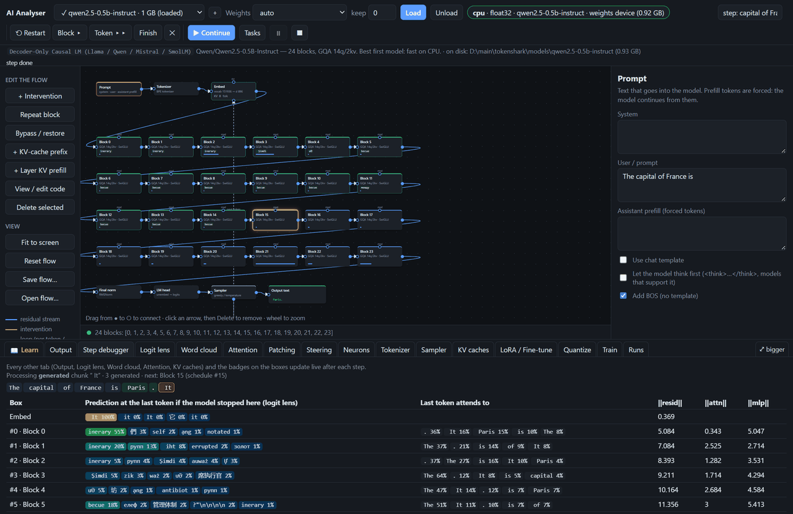

---

## Live Demo: `qwen2.5-0.5b-instruct` Step-by-Step, Word Clouds & Mechanistic Interpretability

### 1. Step Debugger & Token-by-Token Generation

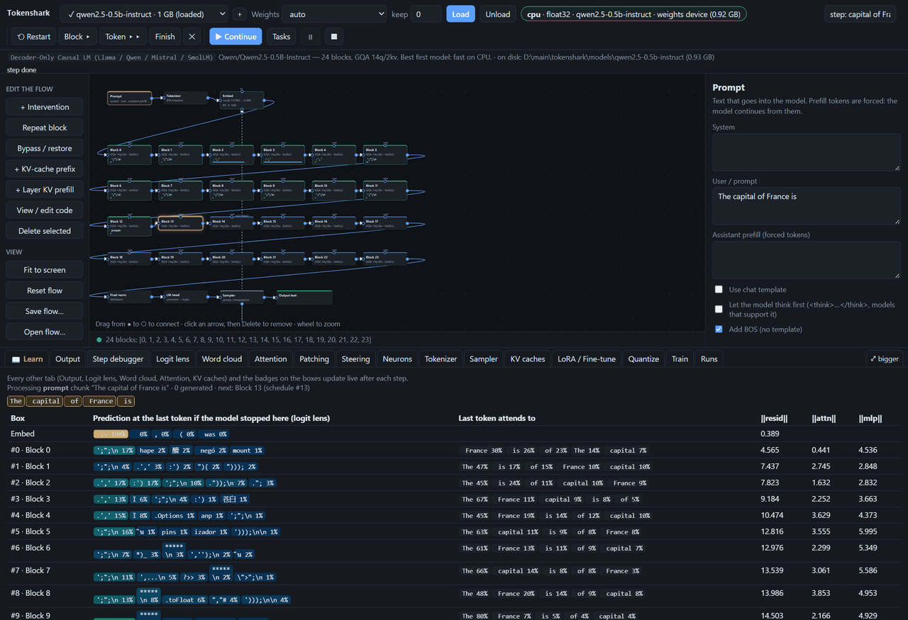

Load `qwen2.5-0.5b-instruct` (24 blocks, GQA 14q/2kv, SwiGLU) and press **🐞 Step**:
- **Block ▸** (`F10`) runs one box at a time; **Token ▸▸** (`F11`) runs to the next token prediction; right-click any block → *Debug: run to here*.
- The box about to run is highlighted in gold on the flow graph (`Block 21` below), while already-executed blocks are outlined in green with live logit-lens badges.
- Generated tokens (`Paris`, `.`, `It`, `is`, `the`, `largest`) appear in green alongside the prompt tokens, with a live per-block trace showing what each layer would predict if the model stopped there, which earlier tokens the last token attends to, and `‖resid‖`, `‖attn‖`, and `‖mlp‖` norms.
- At any token boundary, click any of the **top-10 next-token choices** to force that token and fork the generation.

| Mid-Token Block Stepping (`Block 21` active) | Token Boundary Prediction (`Paris` at 30.2%) |
|---|---|
| 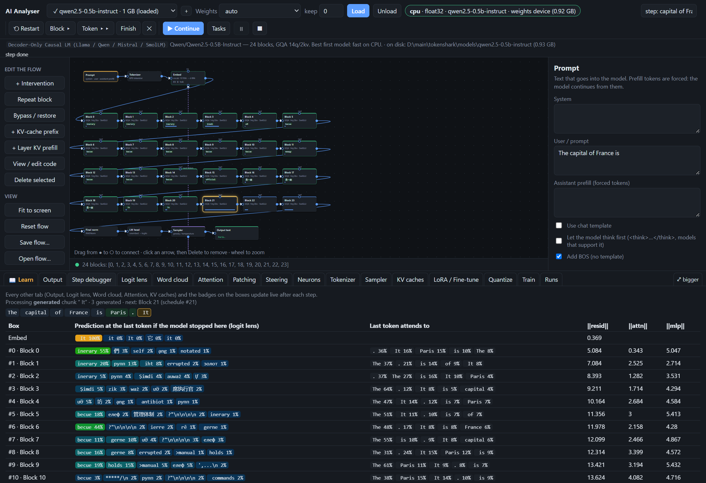 | 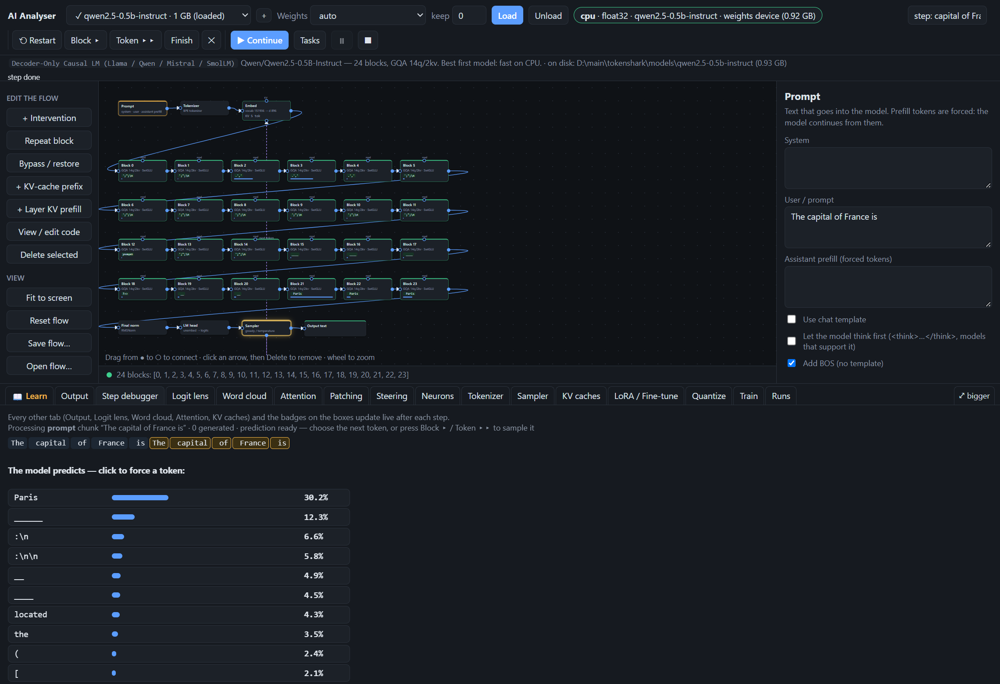 |

### 2. Word Clouds & Direct Logit Attribution ("Through the Last 2 Blocks")

Plain logit lens (final norm + unembedding applied directly to an early layer) reads early layers poorly because middle blocks do not yet speak the final output vocabulary space. Setting **Decode with → `through the last 2 blocks, then unembed`** routes each chosen layer's residual stream through the last 2 transformer blocks before unembedding:

| Word Clouds Decoded Through Last 2 Blocks | Word Tracking & Direct Logit Attribution (`"Paris"`) |
|---|---|
| 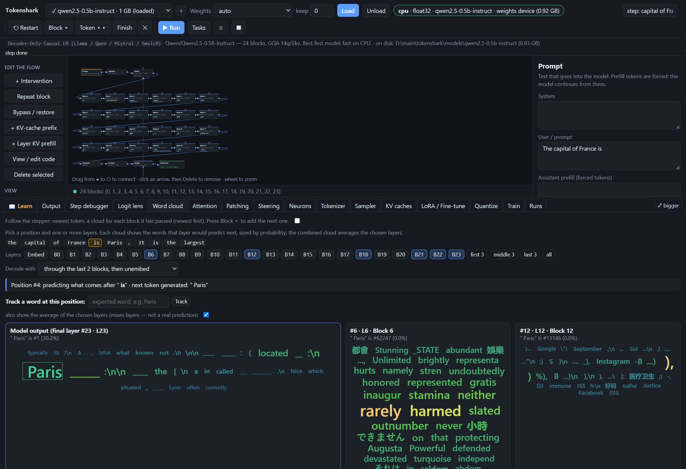 | 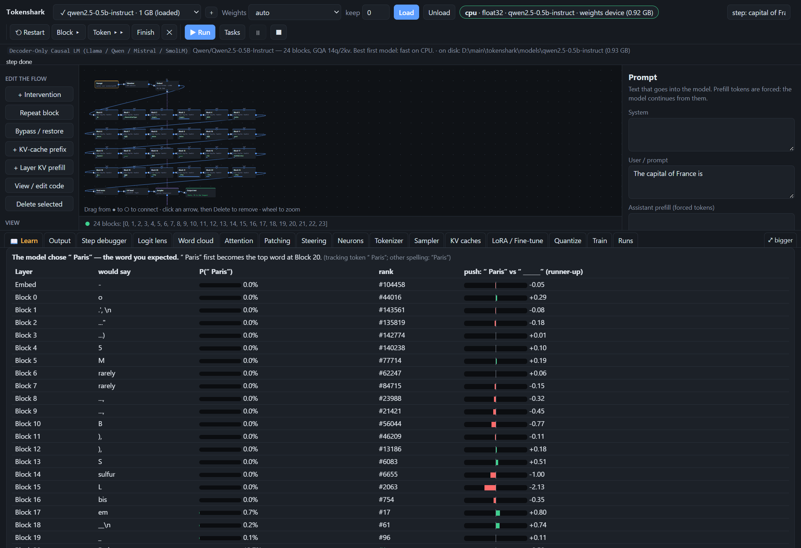 |

| Logit Lens Grid (Decoded Through Last 2 Blocks, Layers 11–23) | Output Tokens & Alternatives |
|---|---|
| 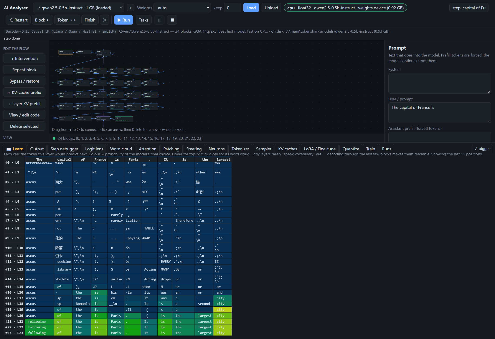 | 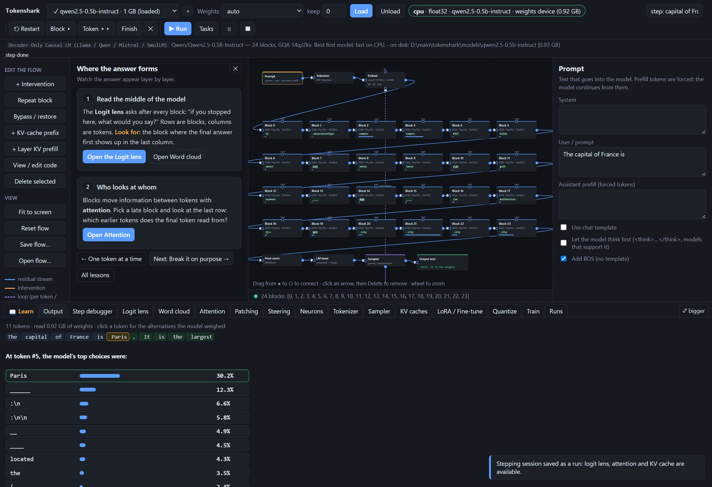 |

---

## Core Features

### Flow Editor & Raw PyTorch Engine
- **Flow editor.** Each model is drawn as boxes and arrows (`prompt → tokenizer → embed → blocks → norm → head → sampler`, `prompt → CLIP → UNet stages → VAE`, or `prompt → Qwen3-VL → 32 single-stream DiT blocks → Wan VAE`). Re-wire arrows to remove, repeat, or re-order transformer blocks; wire intervention boxes into a block's top port to zero, scale, add noise, mean-ablate, patch, steer, or clamp an activation.
- **Bypass keeps the block.** A bypassed block stays on the canvas, struck through; the residual stream skips it. Restore it from the right-click menu or the inspector.
- **Raw PyTorch engine.** No `transformers`, no `diffusers` at runtime. Every matmul is in `tokenshark/llm/`, `tokenshark/sd.py`, and `tokenshark/qimage.py`, small enough to read in class.
- **Declarative model & feature plugin architecture.** Each model family is a self-contained plugin in `tokenshark/plugins/` (`causal_lm.py`, `gemma4.py`, `stable_diffusion.py`, `qwen_image_21.py`), and every specialized analysis or intervention feature is a modular extension in `tokenshark/extensions/` (`patching`, `steering`, `neurons`, `moe`, `introspect`, `lora`, `quant`, `training`, `guardrail_fork`, `attn_traceback`, `datasets`) built on `tokenshark/sdk.py` and toggleable live from the **Extensions ▾** header menu.

### Editable Box Code & Export to Python Script
- **Editable box code (`tokenshark/blockcode.py`).** Click **View / edit code** on any language-model box (`Embed`, any `Block`, `Final norm`, `LM head`, `Sampler`) to view the exact ~15 lines of Python it runs (`rms_norm`, `heads`, `remember(k, v)`, `rope`, `softmax`, `silu`, `unembed`). Edit the code in the browser (e.g., remove `x = x + mlp_out`, scale `attn_out`, or write a custom sampler) and the engine executes your Python in place of the built-in step, capturing `print(...)` output.
- **Export run as Python script (`tokenshark/export.py` & `tokenshark/api.py`).** Any run in the browser (including its block schedule, bypasses, patches, steering vectors, neuron clamps, layer prompts, LoRA/quantization overlays, and custom box code) can be exported as a standalone Python script using `from tokenshark.api import Lab`.

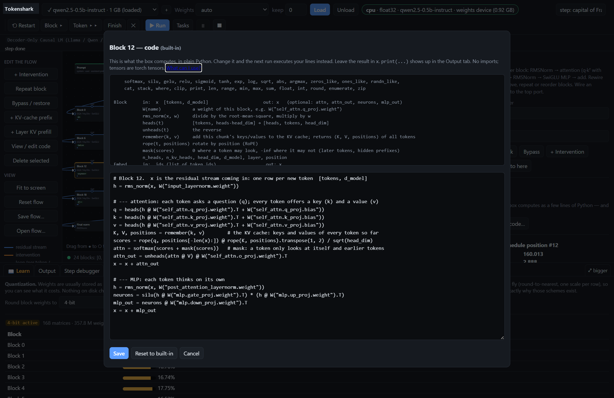

### Mechanistic Interpretability Lab Tools & Modular Extensions
- **Previous-Token Attention Attribution (`Attention` tab, `tokenshark/extensions/attn_traceback/`).** In addition to single-block heatmaps and QKV head ablation, switch to **Previous-Token Attribution (All Layers × Heads)** to rank every `(block, head)` pair across the entire model for any target token by attention probability, value-weighted output norm $\|\alpha \cdot v W_O\|_2$, and direct target-word logit push, with one-click head knock-out wiring.
- **Center-Layer Guardrail Fork (`Guardrail` tab & `+ Fork Head` box, `tokenshark/extensions/guardrail_fork/`).** Wire a side-branch classifier (`linear_probe`, `mlp_guard`, or `block_branch`) to any transformer block's bottom `fork` port. Train a fast guardrail head on frozen middle-layer activations (including the built-in `powershell_detector` preset for `PowerShell` vs `Python / General`) and run it in `monitor` mode (live probability telemetry) or `gate` mode (early-exit generation halt at the middle layer).
- **Activation patching / causal tracing (`Logit lens` & `Patching`, `tokenshark/extensions/patching/`).** Run a clean prompt (`"The capital of France is"`) and sweep a corrupted prompt (`"The capital of Japan is"`) across every `(block, token)` pair, copying one activation (`resid_post`, `resid_pre`, `attn_out`, or `mlp_out`) at a time to locate where the model stores a fact. Click any heatmap cell to wire that exact patch into the flow.
- **Neuron hunting, contrastive A/B activity & wiring (`Neurons` tab, `tokenshark/extensions/neurons/`).** Inspect the strongest MLP neurons in any block, compare Group A vs. Group B prompt sets, project unembedding directions, and wire detector neurons into writer neurons (`op="wire"`) or clamp neurons (`op="clamp"`).
- **Steering vectors & subspace projection (`Word cloud` & `Steering`, `tokenshark/extensions/steering/`).** Build contrastive directions in the residual stream from two runs (`run A − run B` at a block) or from a word's unembedding row (`"Paris" − "Tokyo"`), save them to `data/vectors/`, and wire them into any block to steer (`op="steer"`) or erase a direction (`op="project_out"`).
- **Tokenizer explorer & Sampler playground (`Tokenizer` & `Sampler` tabs).** Inspect BPE splits, word-to-token dictionaries, byte/char ratios, chat-template wrapping, vocabulary search, and cosine-nearest embedding neighbors. In the Sampler tab, adjust temperature, top-k, and top-p live on a captured logit distribution, compute entropy in bits, and draw 200 samples without re-running the model.

| Activation Patching (Causal Tracing Heatmap) | MLP Neuron Hunting, Vocabulary Push & Clamping |
|---|---|
| 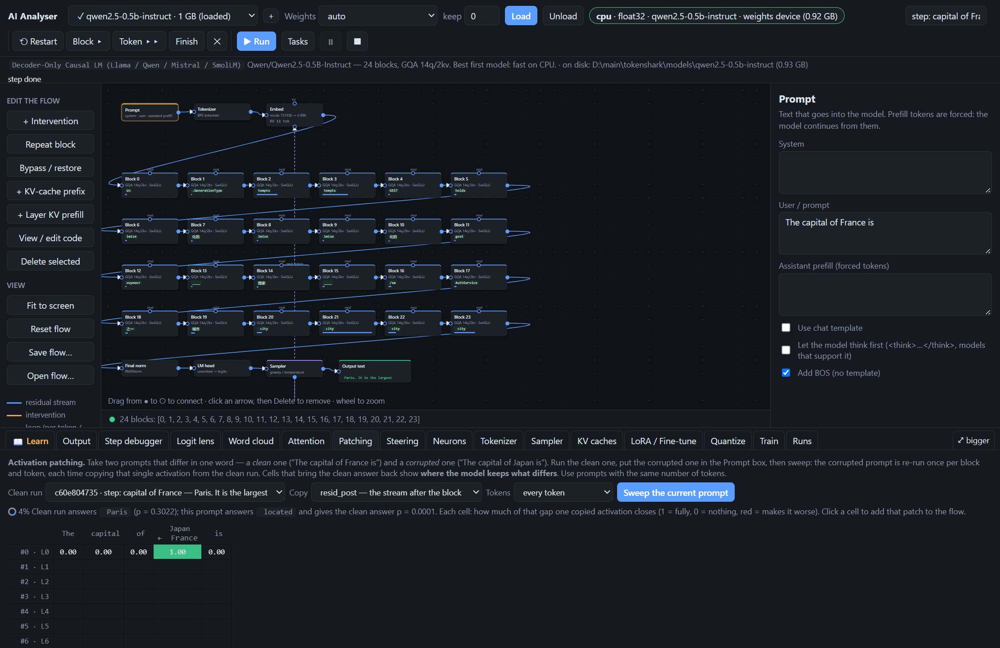 | 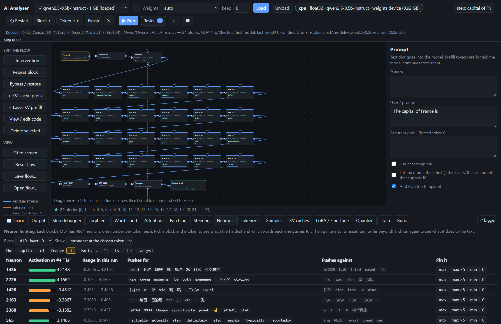 |

### Mixture-of-Experts Models: Routers & Experts You Can See and Change
- **MoE engine (`tokenshark/llm.py`).** Mixtral, Qwen1.5/2-MoE, Qwen3-MoE, Qwen3.5-MoE, OLMoE and DeepSeek-V2 (latent attention, YaRN positions, shared experts, grouped routing) run in the same raw PyTorch engine, checked logit-for-logit against `transformers` on tiny models of each family (`tests/test_moe.py`) and on two real checkpoints streamed from disk - the 27 GB `Qwen1.5-MoE-A2.7B-Chat` and the 29 GB `DeepSeek-V2-Lite-Chat` (same top-1 token at every position, logit correlation above 0.999, identical expert routing). The layout (router, per-expert or stacked expert tensors, shared expert) is detected from the checkpoint. With `stream from disk`, only the experts a token is routed to are read.
- **Experts on the flow graph.** Every MoE block shows one cell per expert, shaded by how many tokens of the last run used it; the newest token's experts are outlined. Click a cell to pick an expert and **ban**, **force** (`only`), **silence** or **amplify** it from the inspector. A block's inspector also sets *experts per token* (`k`) and the *router temperature*.
- **`Experts` tab (`tokenshark/moe.py`).** Usage of every expert in every block with router entropy; each token coloured by its top expert; the router's full score distribution at a token; what each chosen expert *wrote* there, read as words, and its push for the answer (direct logit attribution per expert); per-expert pages (where it fired, what it writes, which experts it competes with); and a **knock-out sweep** that removes one expert at a time and reports the damage.
- **Custom routing.** Take the router's job yourself: in a block's inspector build a *custom route* - pick experts and give each a weight (`3=0.7, 5=0.3`; a slider per expert; an empty weight keeps the router's own score; negative weights subtract an expert's write) - for every token or only some. Blocks with a **shared expert** have a switch to turn it off. From Python: `flow.route(block, {3: 0.7, 5: 0.3})`, `flow.shared_expert(block, False)`.
- **Edits carry through every calculation.** Whatever you change - a banned expert, a custom route, a steering box, edited code - is part of the logit lens, word clouds and word tracking (including *decode through the last k blocks*, which re-runs those blocks as edited), of the patching and knock-out sweeps, and of the introspection experiments, not only of the run itself.

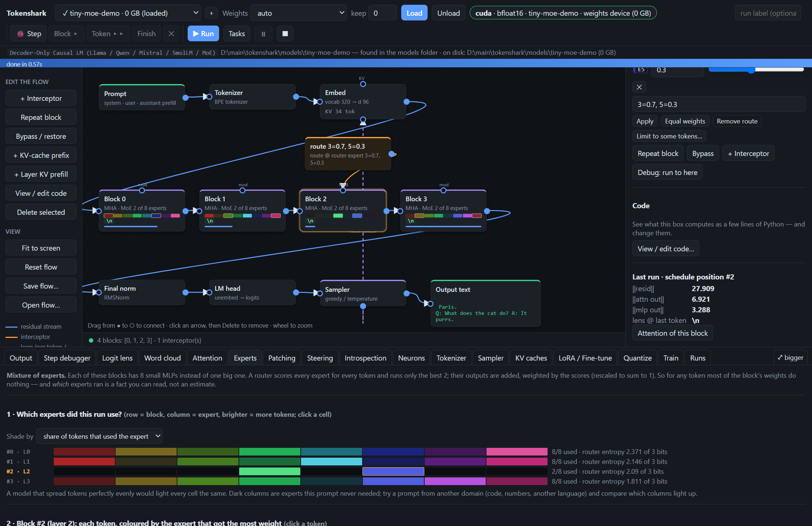

- **Two new hooks, three new ops.** `router` (the scores before top-k: `ban`, `only`, `route`, scale, noise, and `patch` - copy *only the routing* from another run) and `expert_out` (one expert's output before it is weighted and summed). The `Patching` tab can sweep `router`.
- **Train a tiny MoE (`Train` tab).** Set *Experts per block* > 0: the tiny model gets a router and experts with a load-balancing loss, and a live chart of each expert's share of tokens.

| Experts on the graph + inspector | `Experts` tab: usage, routing, what each expert wrote |
|---|---|
| 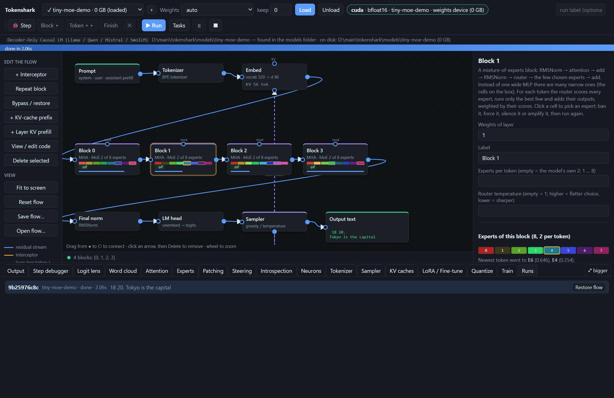 | 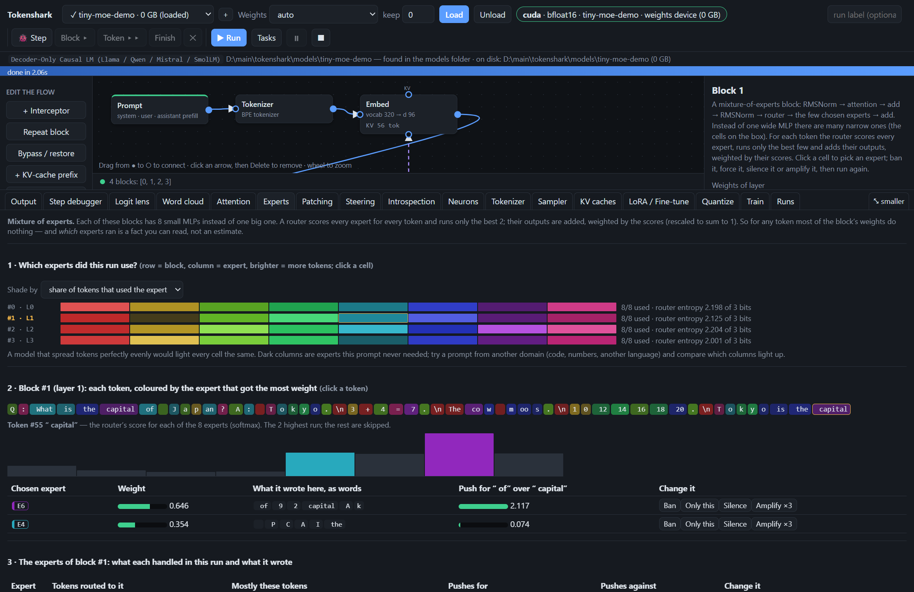 |

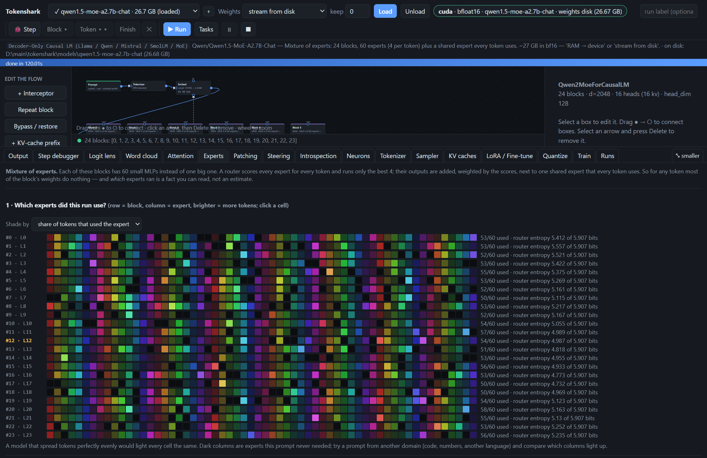

### Introspection Lab (`Introspection` tab, `tokenshark/introspect.py`)
Classroom-scale versions of two lines of Anthropic research - [Signs of introspection in large language models](https://www.anthropic.com/research/introspection) and [Natural Language Autoencoders](https://www.anthropic.com/research/natural-language-autoencoders) - on whatever open model is loaded:
- **Concept injection.** Build concept vectors by contrast, add them at chosen blocks and strengths while the model answers “Do you detect an injected thought?”, and grade the answers (detects → names, false positives on a control trial, coherence). One click wires any trial into the flow as a steering box.
- **Concept meter.** How strongly every block's residual stream points along a concept, token by token - the measurement behind “think about X / don't think about X”.
- **Activation → words → activation.** A natural-language autoencoder with nothing trained: the model verbalizes one of its own activations (patched into “what does ▢ mean?”), the explanation is read back, and the rebuilt activation is scored against a ceiling and a floor. Type your own explanation and try to beat it.

Small models mostly *fail* these tests (Qwen2.5-0.5B says “yes, I detect it” with nothing injected); the tab is built to show how, with the controls that make it a measurement.

| Concept injection sweep with control trial | Activation → words → activation |
|---|---|
| 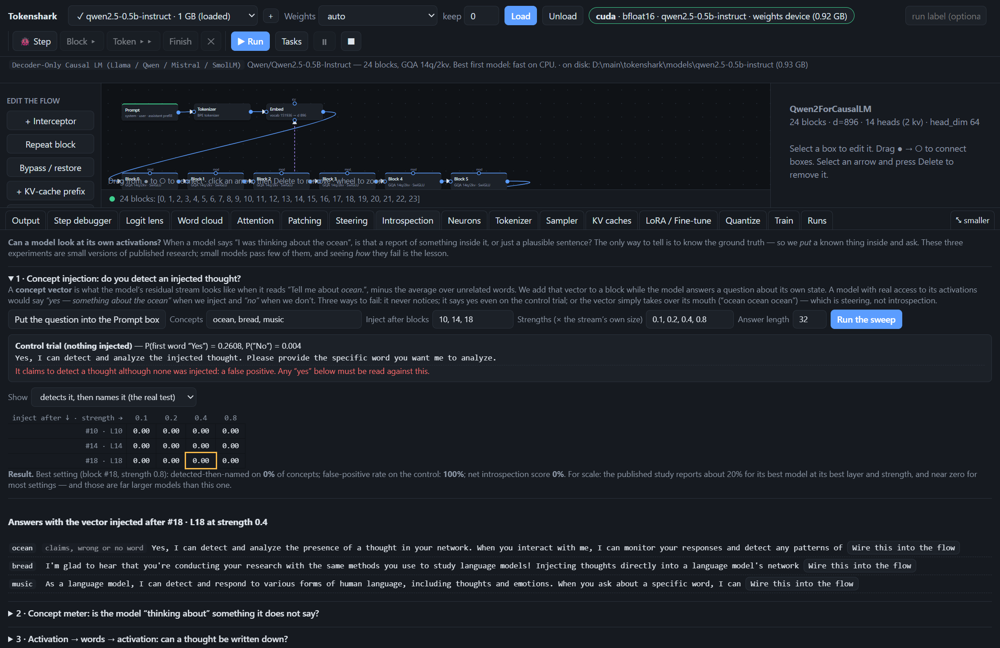 | 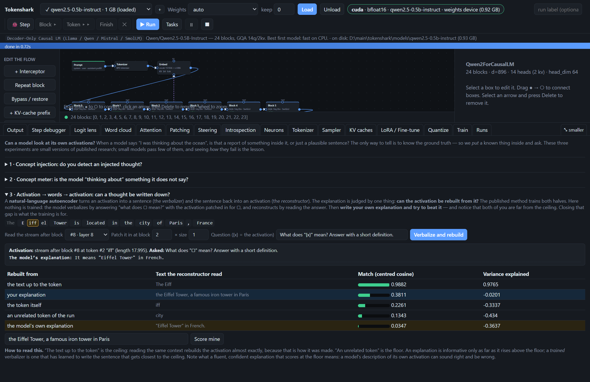 |


### Multi-Turn Conversations
- **Write the conversation so far.** The Prompt box has a list of *earlier turns* - user and assistant, in any order - in front of the prompt. With the chat template on each is wrapped as a real turn. Assistant turns are words you put in the model's mouth: plant “The capital of France is Lyon.” and ask a follow-up to watch the model stay consistent with something it never said.
- **Continue after a run.** The Output tab shows the whole conversation and a box for the next message: **Send** moves the exchange into the earlier turns and runs the new turn, with every interceptor, bypass and code edit still in place. *Keep as earlier turns* does the same without running, so the model's answer can be edited first.
- **Python.** `lab.flow(prompt, history=[{"role": "user", "content": …}, …])`, `flow.say("assistant", "…")`, `run.conversation`, and `run.reply("next message")`.

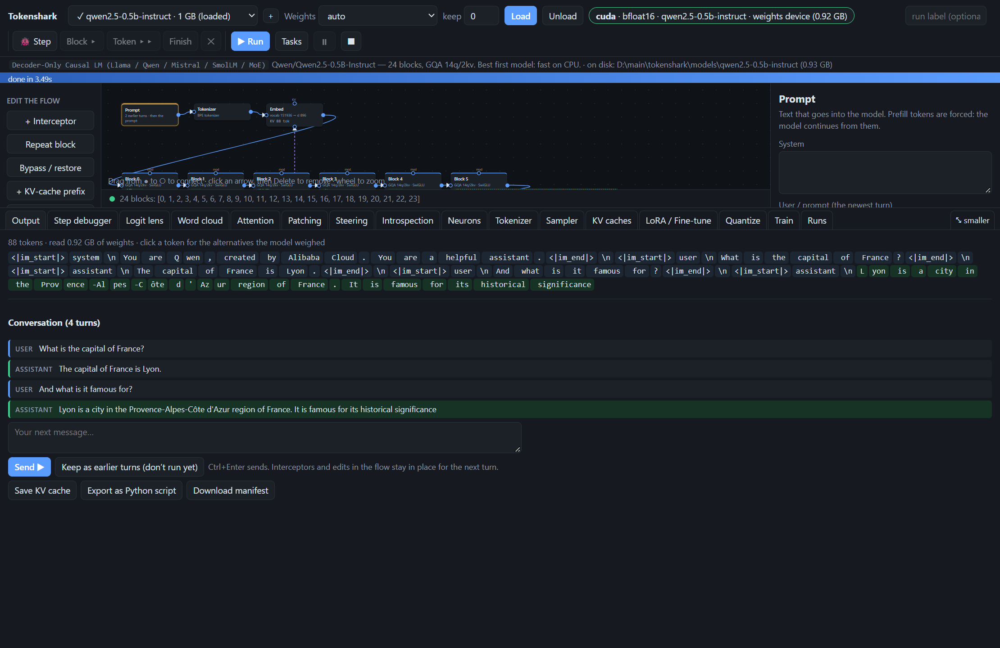


### Editable KV Cache & Per-Block Prompt Rewrite
- **Pre-RoPE KV cache (`tokenshark/kvcache.py`).** Keys are stored *before* RoPE with an explicit position per token, so a cache saved from one conversation can be prepended to another (`shift` / `negative` / `offset`), exported/imported as `.safetensors`, and surgically edited (`truncate`, `keep`, `drop`, zero/scale/quantize K or V per block).
- **Rewrite prompt per block.** Wire **+ Rewrite prompt (KV)** into a full-attention block’s **KV** port (linear / Gated DeltaNet blocks have no KV cache). Ops: `replace_system`, `append_system`, `prepend_system`, `replace_user`, `append_user`, `prepend_user`. Tokenshark recreates that block’s KV cache from the rewritten prompt, then grows it as tokens are generated. From Python: `flow.replace_system("…", blocks="12:24")`.

### LoRA / Fine-Tune Inspector, Quantization & In-Browser Training
- **LoRA & fine-tune overlay (`LoRA / Fine-tune` tab, `tokenshark/lora.py`).** Attach any Hugging Face PEFT LoRA, Diffusers/Kohya `.safetensors` LoRA, or full fine-tuned checkpoint at the `WeightStore` level. Inspect exact Frobenius norms `‖ΔW‖_F`, relative change `‖ΔW‖ / ‖W‖` per block and module (`q_proj`, `v_proj`, `mlp`), highlight the most-changed blocks on the flow canvas, and slide the LoRA scale live from `-2.0×` (anti-LoRA) to `+3.0×`.
- **On-the-fly quantization (`Quantize` tab, `tokenshark/quant.py`).** Round block weight matrices on the fly to `8`, `6`, `4`, `3`, `2`, or `1` bit (per-row symmetric RTN), measure per-block rounding error `‖W − round(W)‖ / ‖W‖`, and compare generated text, top-1 agreement, and KL divergence against full precision token-for-token.
- **Train models from scratch or adapt the loaded LLM (`Train` tab, `tokenshark/train.py`, `tokenshark/adapt.py`, `tokenshark/extensions/datasets/`):**
  1. **Tiny language model from scratch:** Train a custom Llama-architecture or Mixture-of-Experts transformer + BPE tokenizer on synthetic corpora, the built-in **2,000-question `multiarith_cot` step-by-step reasoning dataset**, or custom uploaded `.jsonl`/`.csv`/`.txt` datasets with a HuggingFace-style 2-column Question/Answer preview table, configurable question count (`n_questions`), and custom system prompt.
  2. **6 adaptation methods on the loaded LLM:** Compare `lora`, `full` (chosen matrices), `ia3` (per-row scaling), `norms` (RMSNorm weights), `adapter` (bottleneck layer after chosen blocks), and `new_block` (insert a whole new block initialized as `duplicate`, `average`, `identity`, or `random`), with 2-column Q&A dataset preview and custom system prompts.
  3. **Tiny flow-matching image model:** Train a 16×16 flow-matching denoiser on colored shapes with a held-out combination (`yellow triangle`) to watch compositional generalization and CFG emerge live.

| In-Browser Training (Tiny LLM, Flow-Matching Image & Adaptation) | LoRA / Fine-Tune Weight Diff Inspector |
|---|---|
| 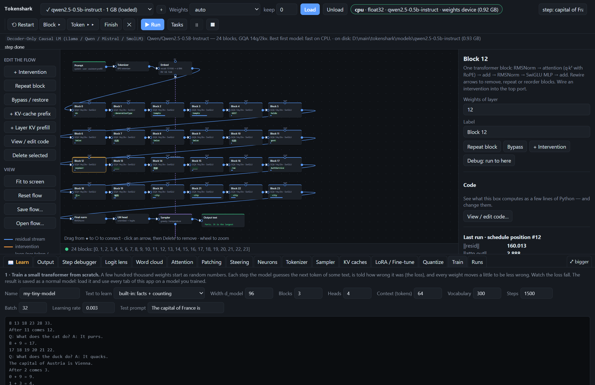 | 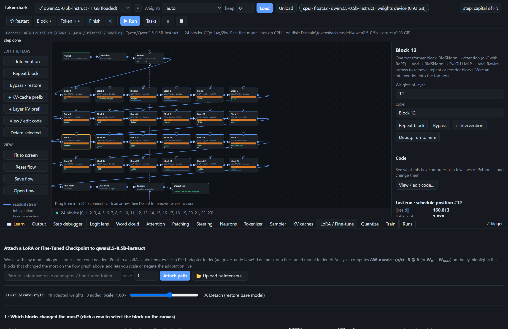 |

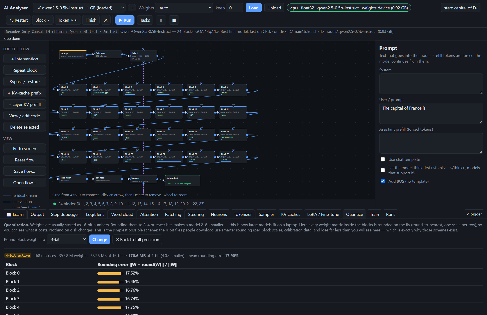

### Image Generation: Stable Diffusion UNets & Qwen-Image 2.1 Single-Stream DiT
- **Stable Diffusion UNet (`tokenshark/sd.py`) & Qwen-Image 2.1 DiT (`tokenshark/qimage.py`).** Full support for both multi-scale UNet models (`sd-turbo`, `tiny-sd`, `sd-1.5`) and `qwen-image-2.1` (32-block 7B single-stream DiT + 36-block Qwen3-VL 8B text encoder + 64-channel 16× Wan VAE).
- **Interactive diffusion step debugger & between-step image editing (`debug_image`).** Step through Qwen-Image block by block or step by step, paint edits onto the model's current guess `x̂₀` between steps (preserving the noise `ε̂`), adjust the between-step noise level `σ ∈ [0.02, 1.0]`, or extend the schedule with extra refinement steps.
- **Image lens ("Decode through last k blocks", `ilens` tab).** Project any intermediate DiT block's image tokens into pixel space (via fast fitted linear preview or exact VAE decode), either directly or after jumping through the last `k` blocks.
- **Block contributions (`contrib` tab).** See *where* each stage writes (residual update heatmap), *what* it encodes (3-component PCA RGB map), and *how much it matters* (ablation diff and ranking), plus a two-row per-step strip showing the noisy input `x_t` and predicted `x̂₀` at every step.

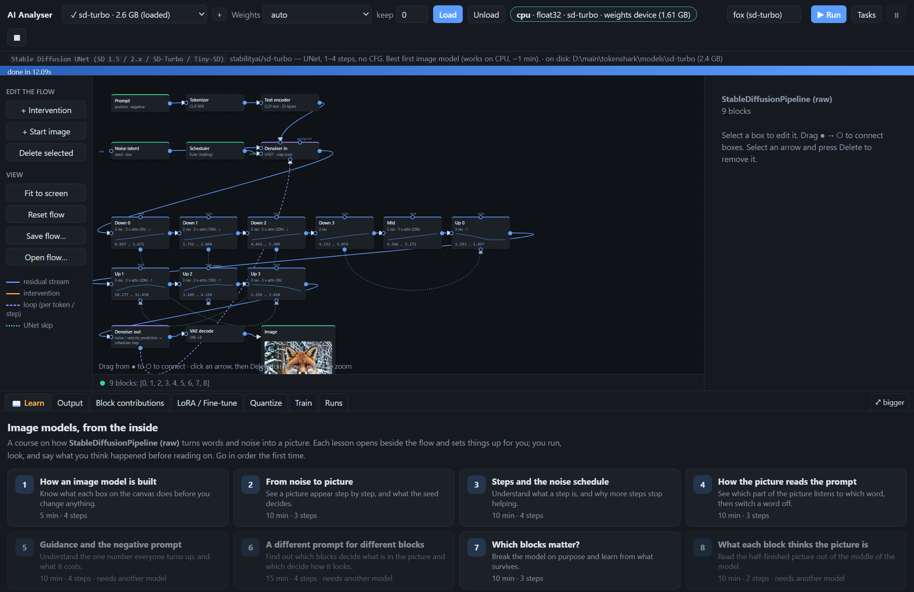

### MCP Tutor Server
- **MCP Tutor Server (`tokenshark/mcp_server.py`).** Zero-dependency stdio MCP server (`python -m tokenshark.mcp_server`) that lets Claude Desktop, Claude Code, or Cursor drive Tokenshark as an interactive tutor. Every run, intervention, and patching sweep performed by the tutor appears live in the student's browser.

---

## For Educators / Coursework

- **Readable, wrapper-free forward passes:** Every transformer and diffusion operation (`tokenshark/llm.py`, `tokenshark/sd.py`, `tokenshark/qimage.py`) is written in explicit, single-file PyTorch without `transformers` or `diffusers` at runtime, and any block opens in the browser as ~15 lines of editable Python.
- **Runs on standard student laptops:** Pure Python with zero Node.js/build steps (`run.bat` / `./run.sh`); 0.5B–1.7B models and from-scratch training run on CPU in seconds, while layer streaming (`disk` policy) lets students inspect 27B–70B models without a cluster.
- **Reproducible homework & grading:** Students can save flows (`.json`), export any browser experiment, including patches, steering vectors, and custom block code into a standalone Python script (`tokenshark.api`), or pair with an AI teaching assistant via the built-in MCP tutor server.
- **Adopt or cite in your syllabus:** Free for university courses, workshops, and training bootcamps. See [`CITATION.cff`](https://github.com/sumit-1/tokenshark/blob/main/CITATION.cff) to cite Tokenshark in lecture notes, lab handouts, or academic publications.

---

## Run It

Windows: double-click `run.bat`. macOS / Linux: `./run.sh`. The first run creates `.venv` and installs `requirements.txt`. Then open http://127.0.0.1:8000.

```bash
python -m venv .venv && . .venv/bin/activate     # Windows: .venv\Scripts\activate
pip install -e .                                 # or: pip install -r requirements.txt
tokenshark                                       # or: python -m tokenshark (--port 8000 --device auto|cuda|mps|cpu --dtype auto|fp32|fp16|bf16)
```

Choose a model, choose where its weights live, and click **Load**. On first use the model downloads from Hugging Face into **`models/<id>/`** next to the app (change with `--models-dir D:\models` or the `TOKENSHARK_MODELS` variable). Only configs, the tokenizer, and one copy of the weights are fetched (fp16 for the image models). They're plain files with no hidden cache: copy, move, or delete them like any folder. A `✓` in the model list means it is on disk, and `🗑` deletes it. Any model folder you drop into `models/` (with `config.json`, Meta `params.json`, or `model_index.json`) appears in the list automatically. Then edit the flow and click **Run**.

| Weights setting | What happens | Use when |
|---|---|---|
| `auto` | picks from model size vs free memory | default |
| `all on GPU/CPU` | everything resident on the compute device | it fits |
| `RAM → device per layer` | resident in RAM, copied to the GPU block by block | fits in RAM, not VRAM |
| `stream from disk` | nothing resident; each block is read from the memory-mapped file when it runs | bigger than RAM (e.g. 27B–70B on a 16 GB laptop) |

`keep N` keeps the first `N` blocks resident on the device while the rest stream. Streaming a 70B model reads ~140 GB per forward pass: expect minutes per token on NVMe. It works; it is not fast.

---

## Models

Built-in catalog (`tokenshark/models.json` & `tokenshark/plugins/*.py`):

| Id | Plugin / Family | Size | Notes |
|---|---|---|---|
| `qwen2.5-0.5b-instruct` | `causal_lm` (text → text) | 1.0 GB | 24 blocks, GQA 14q/2kv; best first model, fast on CPU |
| `smollm2-360m-instruct` | `causal_lm` (text → text) | 0.7 GB | Llama architecture, 32 blocks; smallest option |
| `qwen2.5-1.5b-instruct` | `causal_lm` (text → text) | 3.1 GB | 28 blocks; noticeably better answers |
| `qwen3-1.7b` | `causal_lm` (text → text) | 3.4 GB | 28 blocks, per-head QK RMSNorm |
| `llama-3.2-1b-instruct` | `causal_lm` (text → text) | 2.5 GB | gated: accept the licence and run `hf auth login` |
| `gemma-4-12b-it` | `gemma4` (image + text → text) | 24.0 GB | 48 blocks, 5 sliding-window : 1 global; global layers use one shared K=V head and partial RoPE; encoder-free image input |
| `qwen3.6-27b` | `causal_lm` (text → text) | 55.0 GB | hybrid: 48 Gated DeltaNet (linear-attention) + 16 gated-attention blocks (64 total); stream from disk |
| `olmoe-1b-7b-instruct` | `causal_lm` (text → text) | 12.9 GB | **mixture of experts**: 16 blocks × 64 experts, 8 per token; best first MoE model |
| `qwen1.5-moe-a2.7b-chat` | `causal_lm` (text → text) | 26.7 GB | **MoE**: 60 experts (4 per token) + a shared expert |
| `deepseek-v2-lite-chat` | `causal_lm` (text → text) | 29.3 GB | **MoE + latent attention (MLA)**: 64 experts (6 per token) + shared experts |
| `qwen3-30b-a3b` | `causal_lm` (text → text) | 56.9 GB | **MoE**: 48 blocks × 128 experts, 8 per token; stream from disk |
| `mixtral-8x7b-instruct` | `causal_lm` (text → text) | 87.0 GB | **MoE**: 8 large experts, 2 per token; stream from disk (slow) |
| *your own* | `causal_lm` | < 0.01 GB | a tiny MoE trained in the `Train` tab in minutes - the quickest way to try the Experts tab |
| `sd-turbo` | `stable_diffusion` (text → image) | 2.6 GB | UNet, 1–4 steps, no CFG; best first image model |
| `tiny-sd` | `stable_diffusion` (text → image) | 1.0 GB | distilled SD 1.5 UNet |
| `sd-1.5` | `stable_diffusion` (text → image) | 2.0 GB | classic UNet with CFG; reference model for cross-attention maps |
| `qwen-image-2.1` | `qwen_image_21` (text → image) | 33.1 GB | single-stream DiT (32 blocks, 7B) + Qwen3-VL 8B text encoder + 64-ch Wan VAE |

Click **+** next to the model picker to add any Hugging Face repo or local folder (`data/models.local.json`). The raw engine supports:
- **Text (`causal_lm`):** Llama 2/3/3.1/3.2, Qwen2/2.5, Qwen3, Mistral, SmolLM, **Qwen3.5/3.6 hybrids** (Gated DeltaNet linear attention + gated full attention), and **mixture-of-experts** models: Mixtral, Qwen1.5/2-MoE, Qwen3-MoE, Qwen3.5-MoE, OLMoE and DeepSeek-V2 (MLA). Supports Hugging Face `.safetensors` and Meta `consolidated.00.pth` + `params.json` + `tokenizer.model`.
- **Image + text (`gemma4`):** dense Gemma-4 (e.g. `gemma-4-12B`) with image input. Add images in the Prompt box or with `lab.run(prompt, images=[...])`; each fills one `<|image|>` marker in the text (or goes in front of the prompt). Video and audio are not supported.
- **Image (`stable_diffusion` & `qwen_image_21`):** Stable Diffusion 1.x / 2.x UNets (including distilled variants) and Qwen-Image 2.1 single-stream DiT pipelines.

---

## Steering Text & Image Generation

| Tool | Where | What it does | Cross-modal analogue |
|---|---|---|---|
| Activation patch (`op="patch"`) | Patching tab / Intervention box | copies `resid_pre`, `attn_out`, `mlp_out`, or `resid_post` from a source run at chosen tokens | Branch from step `k` |
| Steering vector (`op="steer"`) | Steering tab / Intervention box | adds `value × vector` (`run A − run B` or word direction) to a block's stream | Guidance / word re-weighting |
| Neuron clamp (`op="clamp"`) | Neurons tab / Intervention box | pins chosen MLP neurons to `max`, `min`, or `value` | Feature channel scaling |
| Rewrite prompt / Block KV (`block_kv`) | Palette → `+ Rewrite prompt (KV)` · right-click a block | recreates chosen full-attention blocks’ KV from replace/append system or user prompt; cache grows gradually | Per-block Prompt-KV on Qwen-Image (`+ Other prompt` / `+ Hidden prompt`) |
| Negative prompt + guidance > 1 | Prompt, Scheduler boxes | pushes each denoising step away from the negative text | System prompt / contrastive steering |
| Prompt switch at step `k` | Prompt box | prompt A sets layout in early steps, prompt B paints detail later | Changing the instruction mid-answer |
| Start image + strength / Sketch guide | Palette → `+ Start image` | starts from your image noised by *strength*, or steers only drawn tiles from pure noise (*sketch guide*) | Assistant prefill |
| Region lock (painted mask) | Start image / Intervention box | painted area is locked to start image (*keep*), only painted area changes (*regenerate* = inpainting), or an intervention applies only inside the painted mask | Forced tokens at specific positions |
| Between-step image & noise `σ` edit | Step debugger (`debug_image`) | paint on `x̂₀` between denoising steps while preserving `ε̂`, adjust `σ`, or extend steps | Forcing a token mid-generation |
| Word intervention (`hook="word"`) | Intervention box on a UNet/DiT block | scales how strongly image patches read chosen prompt tokens (`0` removes a word, `2` emphasises it) | Attention head / token ablation |

---

## Python API & MCP Tutor Server

Use the exact same raw engine from Python scripts or Jupyter notebooks (`tokenshark/api.py`):

```python
from tokenshark.api import Lab

lab = Lab("qwen2.5-0.5b-instruct")
run = lab.run("The capital of France is", max_new_tokens=6)
print(run.text)

# Inspect internal activations and logit lens (including decoding through last k blocks)
lens = run.lens(k=5, through=2)
attn = run.attention(block=18)            # [heads, tokens, tokens]
resid = run.resid(block=18, where="post") # [tokens, d_model]
neurons = run.top_neurons(block=19, token=-1, k=10)

# Activation patching: copy block 18's residual stream from the clean run into a corrupted prompt
clean = lab.run("The capital of France is", max_new_tokens=1)
flow = lab.flow("The capital of Japan is", max_new_tokens=1)
flow.patch(18, clean, hook="resid_post", positions="last")
print(lab.run(flow).text)
```

To connect Claude Desktop, Claude Code, or Cursor to a running Tokenshark instance via MCP:

```json
{
  "mcpServers": {
    "tokenshark": {
      "command": "python",
      "args": ["-m", "tokenshark.mcp_server", "--url", "http://127.0.0.1:8000"]
    }
  }
}
```

---

## Project Layout

```text
tokenshark/
  weights.py          WeightStore: safetensors/.bin/.pth, offload policies, per-layer streaming, LoRA/quant hooks
  sdk.py              FeaturePlugin SDK, extension state toggles, and registries (ops, node kinds, forks, datasets, API, MCP)
  building_blocks.py  Core interpretability primitives (activation slicing, logit projection, KV analysis, vocab search)
  llm/                Raw decoder-only LLM package:
    config.py           ArchConfig & checkpoint shape inference (Llama, Qwen2/3, Hybrid Gated DeltaNet, MoE, DeepSeek MLA)
    ops.py              Pure PyTorch math: rms_norm, apply_rope, Gated DeltaNet recurrence, int_quantize
    model.py            RawLLM forward pass, MoE router/experts, and side-branch fork execution
    stepper.py          Interactive token/block Stepper (unified with Run/Pause/Stop/Continue)
    analysis.py         Logit lens, through-last-k-blocks decoding, word clouds, and DLA word tracking
    adapter.py          LLMAdapter entry point (prompt building, media placeholders, info for the UI)
    arch.py             ArchHooks / LayerAttn: the contract a model plugin uses to describe an architecture
    media.py            MediaEncoder contract for image input + image I/O helpers
  kvcache.py          Pre-RoPE KV cache, per-block recreated caches, hybrid linear memory, prepend/edit
  sd.py               Raw Stable Diffusion: CLIP text encoder, UNet, VAE, Euler scheduler, cross-attn & stage maps
  qimage.py           Raw Qwen-Image 2.1: Qwen3-VL text encoder, 32-block single-stream DiT, Wan VAE, ImageStepper
  tokenizer.py        tokenizer.json / tiktoken + Jinja chat templates; pure-Python CLIP BPE
  flow.py             Default flows per model; compile flow (boxes + arrows + side-branch forks) → Plan
  flowbuild.py        FlowBuilder: fluent Python builder for editing flows and wiring interceptors/forks
  engine.py           Run context, built-in & plugin-registered intervention ops, device/dtype choice
  blockcode.py        Editable Python code view and AST-checked execution for LLM flow boxes
  lora.py             WeightStore-level LoRA & full fine-tune overlay with Frobenius norm diff inspection
  quant.py            On-the-fly per-row RTN quantization overlay (1–16 bits) and token-by-token KL comparison
  train.py            Differentiable forward pass, TinyJob (train LLM from scratch) & LoRAJob (PEFT LoRA trainer)
  adapt.py            Model adaptation methods beyond LoRA: full, ia3, norms, bottleneck adapter, new_block
  train_image.py      TinyDenoiser flow-matching trainer on 16×16 colored shapes with CFG and compositional test
  export.py           Export any browser run (and its patch sources) to a reproducible Python script
  api.py              Lab & RunResult Python API for scripts and notebooks (extensible via sdk.py)
  mcp_server.py       Pure-stdlib stdio MCP server for AI tutoring
  server/             FastAPI server package (app.py, models_api.py, runs_api.py, kv_api.py, debug_api.py)
  plugins/            Modular model-family plugins (causal_lm.py, gemma4.py, stable_diffusion.py, qwen_image_21.py)
                      All model-specific knowledge lives here, never in llm/, server/ or web/ (see below)
  extensions/         Modular feature plugins & auto-discovery (patching, steering, neurons, moe, introspect,
                      lora, quant, training, guardrail_fork, attn_traceback, datasets)
  web/                Browser UI in plain ES modules + HTML/CSS (core.js, flow.js, paint.js, ui/*, tabs/*)
tests/
  test_oracles.py       Raw LLM & SD engines vs transformers / diffusers on random weights; KV-cache maths
  test_features.py      Stepper, bypass, word through-k decoding, DLA tracking, region locks, model discovery
  test_hybrid.py        Qwen3.5/3.6 hybrid Gated DeltaNet + gated attention vs transformers & cache roundtrips
  test_moe.py           Mixtral / Qwen-MoE / OLMoE / DeepSeek-V2 vs transformers, router & expert interceptors, introspection
  test_qimage.py        Raw Qwen-Image 2.1 vs diffusers QwenImage21Pipeline, Prompt-KV, sketch guide, ImageStepper
  test_lab.py           Patching, steering, neurons, layer prompts, box code, quantization, adaptation, MCP, export
  test_routes.py        End-to-end HTTP API tests for all lab, quantization, code, and training endpoints
  test_extensions.py    Extension discovery/toggling, custom ops, guardrail forks, attention traceback, CoT datasets, stepper sync
  test_architecture.py  Plugin contract & declarative UI schema verification
  test_gemma4.py        Gemma-4 plugin (text + image) vs transformers, per-layer KV shapes, patchify, plugin selection
```

### Adding a language model family

`tokenshark/llm/` holds generic building blocks and never names a model. A decoder whose `config.json` the generic
reader understands (Llama / Qwen / Mistral style, standard `layer_types`, `sliding_window`, per-layer-type
`rope_parameters`, `per_layer_config`, `final_logit_softcapping`) loads through `causal_lm.py` with no code.
Anything else gets **one plugin file**:

1. `tokenshark/plugins/<family>.py`: subclass `CausalLMPlugin`, set `id`, `priority` (above 0, so it wins over the
   catch-all `causal_lm`), `default_models`, and `matches()` on the checkpoint's `model_type`.
2. Return an `ArchHooks` from `arch_hooks()` (`tokenshark/llm/arch.py`):
   `normalize_config()` rewrites the family's config keys into the generic ones, `configure()` sets engine knobs
   (`cfg.layers[l]` head size / KV heads / window / RoPE / K=V, `embed_scale`, `attn_scale`, `v_norm`,
   `media_token_ids`, `media_bidir`, ...), `media_encoder()` returns a `MediaEncoder`
   (`tokenshark/llm/media.py`) for image input, and `weight_skip_prefixes` lists tower weights the text path
   never reads.
3. Add an oracle test against `transformers` on a tiny random model (`tests/make_tiny.py`, `tests/test_gemma4.py`).

If the engine lacks a building block, add it to `tokenshark/llm/` as a generic, named knob (default off) and set
it from the plugin. Never branch on a model name or `model_type` in `tokenshark/llm/`, `tokenshark/server/` or
`tokenshark/web/`. `gemma4.py` is the worked example.

---

## Tests

```bash
pip install -r requirements-dev.txt
pytest
```

The test suite (**170 tests** across 11 test modules) verifies numerical equivalence against `transformers` and `diffusers` on random weights, hybrid linear/full attention math, Qwen-Image 2.1 DiT bit-exact schedules and latents, step-by-step debugging, unified Run/Stop/Step/Continue state preservation, activation patching, steering, neuron clamping/wiring, center-layer guardrail forks, previous-token attention attribution, quantization, in-browser training, adaptation methods, and UI/extension plugin contracts.
